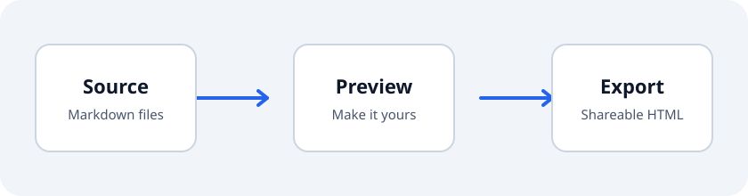
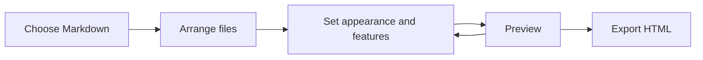

# Explore Compass

Compass turns Markdown into a document you can read, customize, and share. This example is the source for the bundled showcase and the starting document for the local demo.

Try **Customize**, search for a heading with **Ctrl/⌘ K**, and switch on **Focus**. Expand Contents to jump between sections. You can also print the document from your browser.

## Start with a document

Keep content in Markdown and let Compass handle presentation. A document can contain **strong text**, *emphasis*, ~~strikethrough~~, ==marked text==, ^^inserted text^^, inline `code`, and links to [another section](#interactive-tables).

> Good documentation lets readers find the next useful thing without losing their place.

### Organize your work

1. Select or drop your Markdown files into the builder.
2. Put them in reading order.
3. Choose one combined document or separate pages.
4. Adjust appearance and features, preview, then export.

- [x] Write a clear opening.
- [x] Give sections descriptive headings.
- [ ] Replace this example with your own document.

#### Find deeper details

This fourth-level heading is available through Find. The default side outline stays compact; its depth can be changed in the builder.

## Code you can copy

Code fences have syntax highlighting and a copy button.

```python
from pathlib import Path

documents = sorted(Path("demo").glob("*.md"))
for document in documents:
    print(document.name)
```

```javascript
const title = "A document worth reading";
const files = ["introduction.md", "reference.md"];
console.log({ title, files });
```

```bash
pnpm run previews
```

```text
Unknown or omitted languages still render as readable plain text.
```

## Interactive tables

Click a header to sort. Drag its right edge to resize a column, or focus the resize handle and use the arrow keys. This table has more than twelve rows, so the default layout makes it scroll vertically while keeping headers visible. Printing includes every row.

| Feature | Category | Try it |
| --- | --- | --- |
| Accent color | Appearance | Pick a named color or a custom color |
| Text size | Appearance | Adjust the reading size |
| Content width | Appearance | Give the document more room |
| Line spacing | Appearance | Adjust the rhythm of paragraphs |
| Rounded corners | Appearance | Change panel and block corners |
| Contents | Navigation | Expand the opening chapter directory |
| Side outline | Navigation | Jump to nearby sections |
| Find | Navigation | Press Ctrl/⌘ K |
| Focus | Reading | Hide navigation for focused reading |
| Progress | Reading | Watch the reading indicator |
| Reading time | Reading | See the estimate beside the title |
| Code copying | Interaction | Copy the Python example |
| Section links | Interaction | Copy a heading's link |
| Images | Interaction | Click the illustration below |
| Print | Export | Use the browser's print command |
| Saved settings | Preferences | Reopen this document in the same browser |

### Status tables

Three-column tables with Status, State, or Result as the middle header receive compact status badges.

| Practice | Status | Notes |
| --- | --- | --- |
| Keep source Markdown | Done | Rebuild whenever the content changes |
| Check the output | Partly | Review the document at several widths |
| Publish the demo | Not done | Hosting comes after the browser renderer |

## Notes and callouts

> [!NOTE]
> Exports embed the layout styles, controls, favicon, and eligible local images.

> [!TIP]
> Use the section link beside a heading to share a precise place in a document.

> [!IMPORTANT]
> Keep the original Markdown. An HTML export is a publication, not a replacement for its source.

> [!WARNING]
> Mermaid diagrams and MathJax equations use online libraries when enabled. Their source stays readable if those libraries cannot load.

> [!CAUTION]
> Raw HTML is trusted by default in the command-line converter. Use `--safe` to escape it when working with unfamiliar Markdown.

## Images and local assets

This small SVG is a local file, not a screenshot. It is embedded during a normal export. Click it to open the image viewer, then press Escape to close.



When combining files, each file's images are resolved relative to that file's location. The second example, `demo/publishing-checklist.md`, demonstrates links between source documents when both are included in a publication.

## Diagrams

A Mermaid fence becomes an interactive-library-rendered diagram when the network is available and media is enabled.



## Equations

Inline math works inside a paragraph: $a^2 + b^2 = c^2$.

$$
\sum_{k=1}^{n} k = \frac{n(n+1)}{2}
$$

Disable media in the builder to keep diagram and equation source without loading the online libraries.

## Definitions and references

Markdown
: A plain-text format for structured documents.

Standalone HTML
: A shareable file with the Compass layout and controls included.

The browser app and HTML export can be opened without a server.[^offline]

*[HTML]: HyperText Markup Language

Chemical notation can use subscripts, such as H~2~O; ordinary superscripts also work, such as x^2^.

[^offline]: Remote images, linked destinations, Mermaid, and MathJax can still require a network connection.

## Structured assessments

Compass can turn repeated assessment labels into a consistent reading layout. These labels stay out of the side outline.

### Keep examples as source

- What it is: A complete Markdown example stored alongside the code.
- Benefit: Anyone can inspect the syntax and rebuild the same publication.
- Cost: Examples need to be refreshed when behavior changes.
- Us: This showcase lives in `demo/feature-guide.md`.
- Recommendation: Use the showcase to check the browser renderer and exported reader.

## Make it yours

The builder controls whether readers see Customize, Contents, the outline, search, focus, metadata, reading time, code copying, section links, and the footer. You can also choose layout defaults, table behavior, heading case, image zoom, and optional media.

Use this file to explore the controls, or add `demo/publishing-checklist.md` as a second chapter to try combined output. See the repository README for installation and the options reference for the complete configuration.
